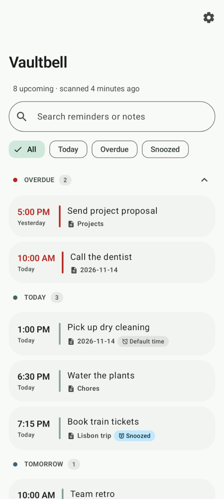
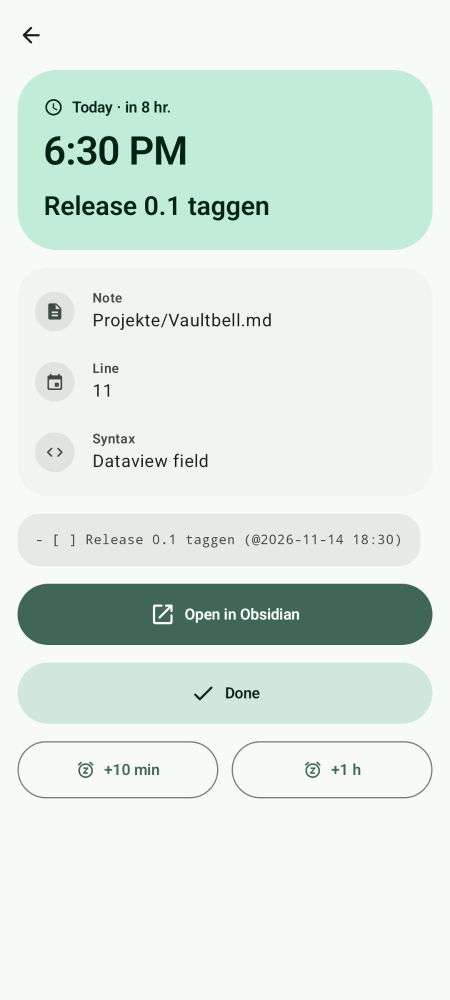
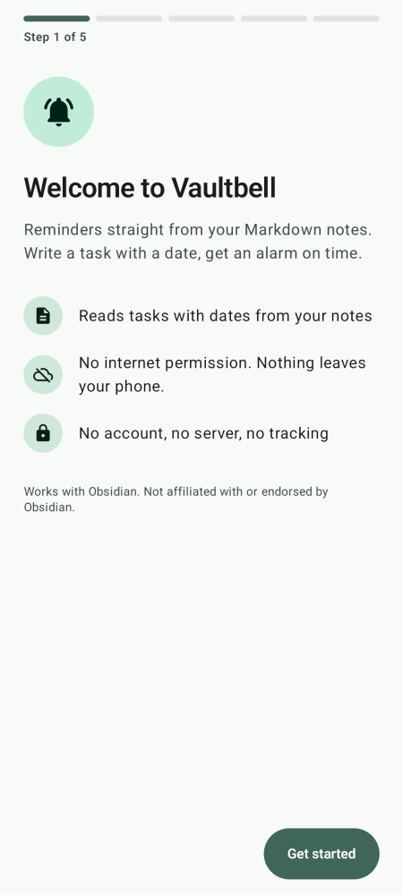
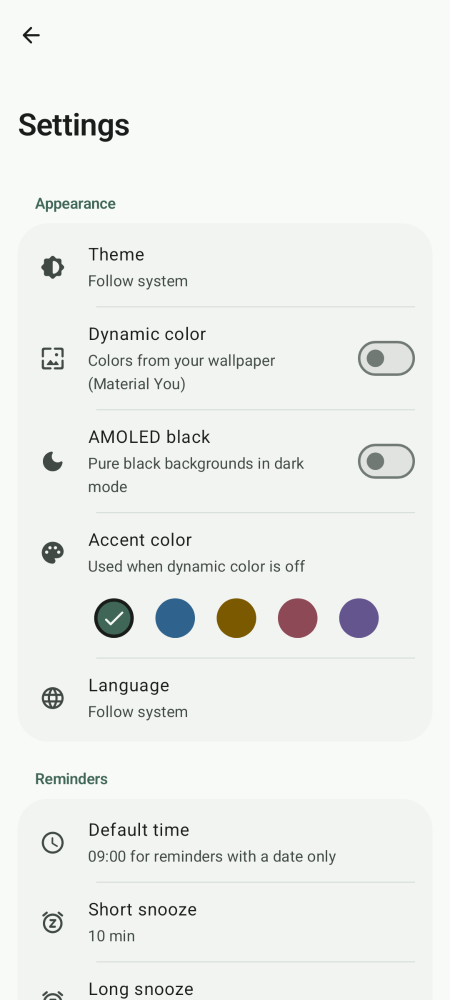

<div align="center">

# Vaultbell

**Local-first reminders for Markdown vaults.**
Write a task with a date in your notes, get an Android alarm on time.
No account. No server. No tracking. No internet permission.

[](https://github.com/descomanian/vaultbell/actions/workflows/ci.yml)
[](LICENSE)

| Reminders | Detail | Onboarding | Settings |
|---|---|---|---|
|  |  |  |  |

</div>

> Works with [Obsidian](https://obsidian.md). Not affiliated with or endorsed by Obsidian.

## How it works

1. Pick your vault folder once (Android's folder picker, no "all files" permission).
2. Write tasks like this in any note:

   ```markdown
   - [ ] Call the dentist (@2026-11-14 18:30)
   - [ ] Take out the trash (@2026-11-15)
   ```

3. Vaultbell scans the folder (on start, on pull-to-refresh and every 15–240 minutes in the background), indexes open tasks with a date and schedules exact alarms.
4. Tap the notification to open the note in Obsidian. Mark it done or snooze it right from the notification.

Supported syntaxes (each can be switched on/off) are documented in [docs/syntax.md](docs/syntax.md):

| Format | Example | Default |
|---|---|---|
| Reminder plugin | `- [ ] Text (@2026-11-14 18:30)` | on |
| Dataview field | `- [ ] Text [due:: 2026-11-14 18:30]` | off |
| Tasks emoji | `- [ ] Text ⏰ 2026-11-14 18:30` / `📅 2026-11-14` | off |
| Note properties | `reminder: 2026-11-14T18:30` in the frontmatter | off |

Repeating reminders work with every task format: `🔁 every day|week|month|weekday` or `| daily|weekly|monthly|weekdays`.

## Principles

- **No `INTERNET` permission.** The merged release manifest is checked in CI.
- **No proprietary dependencies.** No Google Play Services, Firebase or analytics. F-Droid compatible.
- **Storage Access Framework only.** No `MANAGE_EXTERNAL_STORAGE`; access is limited to the folder you choose.
- **Read-only by default.** Writing `[x]` back into a note is opt-in and guarded by a line hash to avoid sync conflicts.

## Features

- Guided onboarding: vault, notifications, exact alarms (Android 14+), with clear explanations.
- Reminder list grouped into Overdue / Today / Tomorrow / Upcoming with sticky headers, search, filters and swipe actions (done / snooze).
- Container transform from list to detail, predictive back, edge-to-edge, haptics.
- Material 3 with Dynamic Color, own fallback palettes (5 accents), light/dark/system and AMOLED black.
- Two-pane layout and navigation rail on tablets and foldables.
- Notification actions: done, snooze short, snooze long. Optional repeat-if-ignored.
- Reminder plan: several early reminders (e.g. 2 h, 1 h, 30 min, 15 min before) and "keep nudging" stages that get denser towards the due time, with active hours.
- Repeating reminders (daily, weekly, monthly, weekdays); done completes only the current occurrence.
- Only one-time tasks are ever checked off in the note. Completed dates of repeating tasks go to a log you can export as Markdown into your vault.
- Note properties as reminders (`reminder`, `due`, `remind`, configurable).
- Lock screen privacy: optionally hide reminders on the lock screen.
- Reminders come through Do Not Disturb and silent mode (delivered as alarms, switchable).
- Reliable background scans: Doze-proof wake-up alarm plus WorkManager, battery exemption in one tap.
- Home screen widget in three sizes with Dynamic Color.
- Incremental scans (only changed files), alarms restored after reboot, time-zone changes handled.
- German and English.


## Contributing

See [CONTRIBUTING.md](CONTRIBUTING.md). Please read the [Code of Conduct](CODE_OF_CONDUCT.md). Security issues: [SECURITY.md](SECURITY.md).

## Privacy

Vaultbell collects no data. See [PRIVACY.md](PRIVACY.md).

## License

[GNU General Public License v3.0](LICENSE)

## FAQ

**A reminder I added on my PC does not show up on the phone.**
Vaultbell reads the files on the phone. Obsidian Sync (and most sync apps) only update those files while the sync app is running. Open Obsidian on the phone once, then pull down in Vaultbell or wait for the next background scan.

**Notifications do not appear in Do Not Disturb.**
Keep *Settings → Reminders → Remind me in silent mode too* on. Reminders are then delivered like an alarm, which Do Not Disturb lets through by default.

**My vault is inside `Android/data` (Obsidian's app folder) and cannot be selected.**
Android does not let other apps open folders inside `Android/data`. Keep the vault in a normal folder such as `Documents/` (Obsidian can open a vault from there).

**Background scans are late.**
Allow background activity (*Settings → System and info → Battery optimization*). Some manufacturers pause apps aggressively; see [dontkillmyapp.com](https://dontkillmyapp.com).
